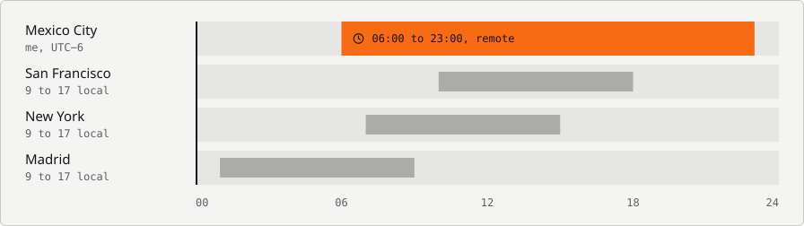

<picture>
  <source media="(prefers-color-scheme: dark)" srcset="assets/banner-dark.svg">
  
</picture>

I'm ilien (Jesus Jimenez), and for seven years I've built software from the database to the screen someone taps. Lately I build tools that run on your own machine and tell you plainly when they fail.

Open to full-time roles and freelance projects, remote from Mexico. I work in English and Spanish, and I'm reachable from 6:00 to 23:00 Mexico City time, which covers the whole US workday and the afternoon in Europe.

### Now

**Svipall 1.0 shipped on 10 September 2026.** It gives an AI agent the web without a cloud service in the middle. It is an MCP server (the protocol AI assistants use to call outside tools) and a CLI, written in Rust. It turns pages into Markdown, crawls sites, searches without an API key and attempts captchas on your own machine. When a site blocks it, it says so, and the agent never gets a challenge page passed off as the article.

One thing went wrong in the release. Three of the five build targets shipped without the captcha models: the prebuilt ONNX Runtime needs glibc 2.38, so a Linux binary linked against it will not start on anything older than Ubuntu 24.04. The next release builds the runtime from source on those targets, and in my tests it starts on Debian 12.

### Work

**[Svipall](https://github.com/ilien-dev/svipall)** &nbsp; <picture><source media="(prefers-color-scheme: dark)" srcset="assets/tier-printed-dark.svg"></picture> 
Web reading for AI agents, on your own machine. Rust, published on crates.io, Homebrew, Scoop and Docker. The benchmarks keep the runs that failed. See it at [svipall.ilien.dev](https://svipall.ilien.dev).

**[svipall-site](https://github.com/ilien-dev/svipall-site)** &nbsp; <picture><source media="(prefers-color-scheme: dark)" srcset="assets/tier-printed-dark.svg"></picture> 
The code behind svipall.ilien.dev: a home page and a docs section. Astro 5, static, Pagefind for search.

**[code-env-config](https://github.com/ilien-dev/code-env-config)** &nbsp; <picture><source media="(prefers-color-scheme: dark)" srcset="assets/tier-press-dark.svg"></picture> 
My Neovim and tmux setup, in Lua.

What the tiers mean

 

Everything I build sits on one rung of this ladder, so a claim about it also says how finished it is.

| | |
|:--|:--|
| <picture><source media="(prefers-color-scheme: dark)" srcset="assets/tier-sketch-dark.svg"></picture> | An idea, written down and nothing more. |
| <picture><source media="(prefers-color-scheme: dark)" srcset="assets/tier-proof-dark.svg"></picture> | Building. It exists, and it does not work yet. |
| <picture><source media="(prefers-color-scheme: dark)" srcset="assets/tier-press-dark.svg"></picture> | Working. It does the thing, for me at least. |
| <picture><source media="(prefers-color-scheme: dark)" srcset="assets/tier-printed-dark.svg"></picture> | Shipped. Other people can use it. |
| <picture><source media="(prefers-color-scheme: dark)" srcset="assets/tier-edition-dark.svg"></picture> | The one I am proud of. |

### How I work

I publish what failed. Svipall's benchmarks keep the failed runs, and its README links an audit of its own claims. When it hits a wall, it names the wall and the next move to try.

Rust, TypeScript and Astro most days. Docker and GitHub Actions for releases, ONNX Runtime for the local models, Neovim and tmux to write all of it.

### Contact

If you're hiring or have a project, write to [contact@ilien.dev](mailto:contact@ilien.dev). I'm also on [LinkedIn](https://www.linkedin.com/in/jjimenezcmx/) and at [ilien.dev](https://ilien.dev).

<picture>
  <source media="(prefers-color-scheme: dark)" srcset="assets/hours-dark.svg">
  
</picture>
Mexico City is UTC−6 all year. The other cities are shown on summer time; in winter each band moves one hour later.

 

  <picture>
    <source media="(prefers-color-scheme: dark)" srcset="assets/mark-dark.svg">
    
  </picture>

