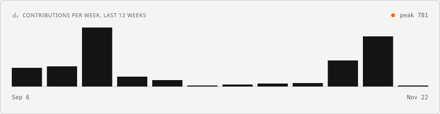

<picture>
  <source media="(prefers-color-scheme: dark)" srcset="assets/banner-dark.svg">
  
</picture>

I'm ilien (Jesus Jimenez). For seven years I've built software from the database to the screen someone taps, and lately I build developer tools that run on your own machine and tell you plainly when they fail.

Open to full-time roles and freelance projects, remote from Mexico. I work in English and Spanish, from 6:00 to 23:00 Mexico City time.

### Stack

<picture>
  <source media="(prefers-color-scheme: dark)" srcset="assets/stack-dark.svg">
  
</picture>

### Activity

<picture>
  <source media="(prefers-color-scheme: dark)" srcset="assets/activity-dark.svg">
  
</picture>

<picture>
  <source media="(prefers-color-scheme: dark)" srcset="assets/weeks-dark.svg">
  
</picture>
Read from the GitHub API and redrawn once a day by an Action in this repo.

### Hours

<picture>
  <source media="(prefers-color-scheme: dark)" srcset="assets/hours-dark.svg">
  
</picture>
Mexico City is UTC−6 all year. The other cities are shown on summer time; in winter each band moves one hour later.

### Contact

If you're hiring or have a project, write to me.

<a href="mailto:contact@ilien.dev"><picture><source media="(prefers-color-scheme: dark)" srcset="assets/mail-dark.svg"></picture></a>&nbsp;
<a href="https://www.linkedin.com/in/jjimenezcmx/"><picture><source media="(prefers-color-scheme: dark)" srcset="assets/linkedin-dark.svg"></picture></a>&nbsp;
<a href="https://ilien.dev"><picture><source media="(prefers-color-scheme: dark)" srcset="assets/site-dark.svg"></picture></a>

 

  <picture>
    <source media="(prefers-color-scheme: dark)" srcset="assets/mark-dark.svg">
    
  </picture>

